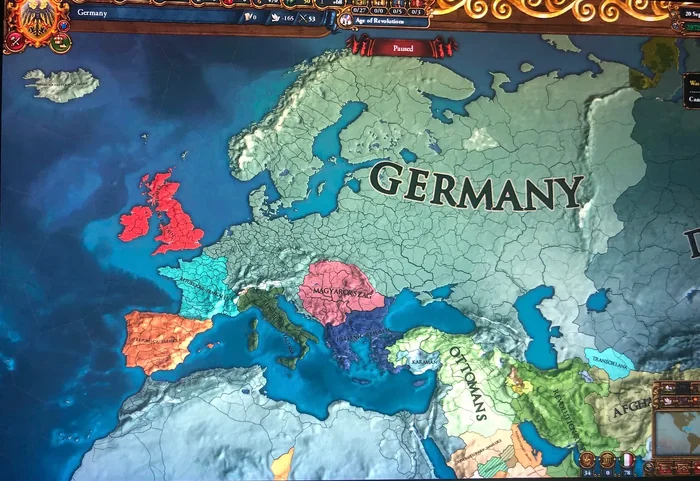
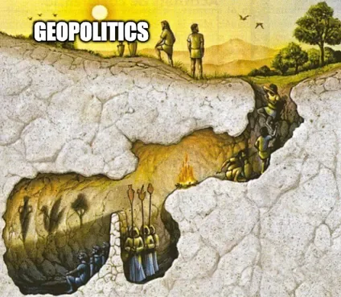
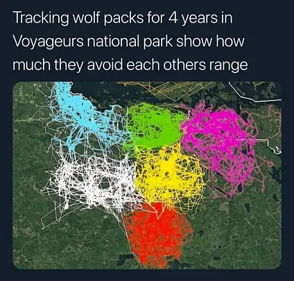
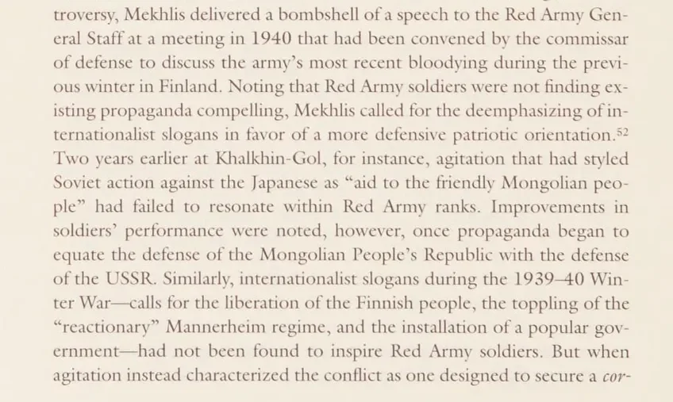
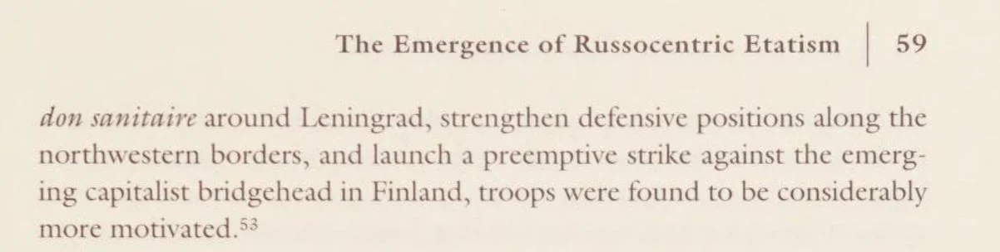

# On Geopolitics

**Author:** Kamil Kazani 
**Date:** 2025-05-07 
**Source:** https://kamilkazani.substack.com/p/on-geopolitics 
**Copied to Keg:** 2026-10-27 

---

There is a theory of international relations - extremely popular among the popular masses - that I would characterise as the geopolitical interpretation of history.

What the geopolitical interpretation implies is that the whole point of wars and conflicts, and schemes, and intrigues is about states fighting for territory.

Everything else is just a disguise

So, basically, if we start a war, the real point of it would be land and its derivatives (resources, strategic locations, zones of interests). But, as we cannot say this openly, we must feed the populace some sort of idealistic lies (“we fight for freedom” “for all the oppressed” “for our brethren in faith”)

Geopolitical interpretation in history presents itself an an ultimate redpill, a short of reality

Based on the naming alone, that makes total sense

If idealism (= values) sounds idealistic

(you can already smell the naive BS)

Then realism sounds, well, real

The final truth

There is, however, a problem with this argument

And the primary problem is that it is popular

The fact that it is so popular, and sells so easily implies that it is probably not true

Accurate beliefs, close to reality tend to scale poorly

And vice versa, to scale well, an idea must be really, really simple

In most cases, that means dumb

It must be so stupid, that even a complete moron can grasp the concept

Then it can acquire a wide, nearly universal popularity

Still, merely pointing to the stupidity (or simplicity) of an idea does not explain how it became popular

There must be something else

In case of geopolitics, that would be the fact that **primary concepts of geopolitics are hardwired into our brain**

We are only semi sapient but highly territorial animals

Our pack, our land, our boundary, it is all wired into our consciousness

And that explains success of the geopolitical interpretation

Geopolitics are popular, because they work well with masses

It is an idea simple enough to be translated to the masses

Which makes it popular for the utilitarian reasons

Let’s imagine you are a politician

You take an action

(for whatever reasons, and motivations)

Or it may not be even you who is taking an action

You may inherit it from a previous administration

You may not even know why they took it in the first place

(you know only the official version of events)

Anyway. Now you have to explain it to the populace, and explain it persuasively

Offering no explanation is not an option either

People will be asking for an explanation and if you refuse to provide it, someone else will

You must offer an explanation, and you must offer that kind of an explanation that the populace will find convincing

Now here we come to the geopolitics

The great thing about geopolitical explanations is that people usually do find them convincing

Because it is hardwired into their brain

Let me give you an example

When Stalin launched major offensive campaigns of the late 1930s, he faced a very practical problem. You have masses of very simple recruits, mostly peasants or recent peasants who had only recently moved to a city. You draft them, train them, arm them, send them to war.

#### Now you need to explain them what they are fighting for

So, the experience of first major military campaigns, in Mongolia (against the Japanese) and in Finland, taught Soviet military propagandists one important lesson

Which is: **idealist explanations do not work**

Troops are not interested in all your sermons about “liberating the workers”, “international solidarity”, whatever. All of that fails to connect.

What troops understand and react positively to is geopolitics

Based on this experience, the Chief Propagandist of Soviet Army Mekhlis (long time Stalin’s secretary) made a conclusion. To hell with idealism. To hell with the communist revolution. Your propaganda must be **geopolitical in nature, because it is the only thing peasants can understand.**

For the Soviets, geopolitics was first and foremost, **a propagandist utility**

Okay, you may ask. You are explaining why the geopolitics are popular. We get it

But why, and where specifically, are they wrong?

What is false about the geopolitics?

To that, I will answer:

The greatest delusion about foreign policy is that the foreign policy is about foreign policy. Not true. In fact, almost no politician in the world is invested in foreign policy that much. Every political player is invested about scoring few more points at home, and that's it.

That is why geopolitics are fake btw. No one is invested in it, at all. A politician will flush all the geopolitical considerations in the world down the toilet, all to score few more political points at home. Politics is all about seizing power at home, and then guarding it, again at home.

That takes 99% of all your attention, and all the other stuff is just busywork

Contrary to what the geopolitical interpretation of history is saying, it is only the tools of politics that are foreign. The goals, on the other hand, are almost always domestic.