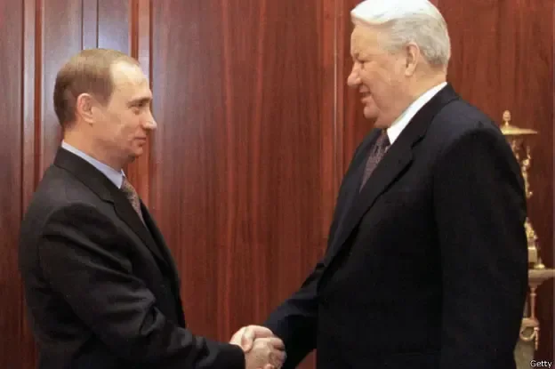
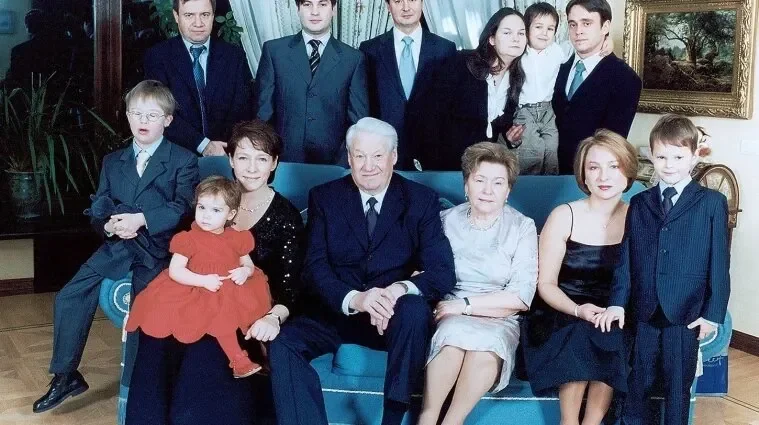
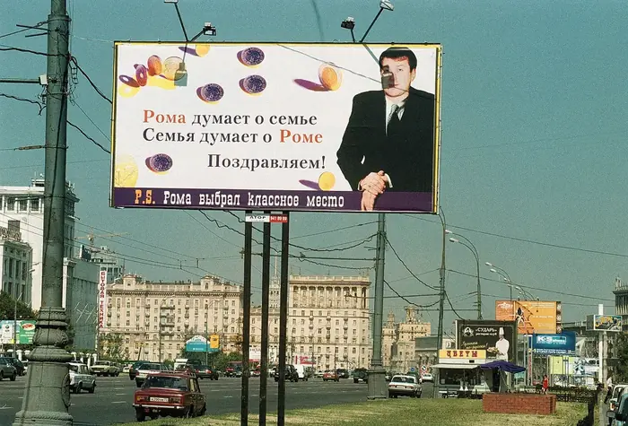
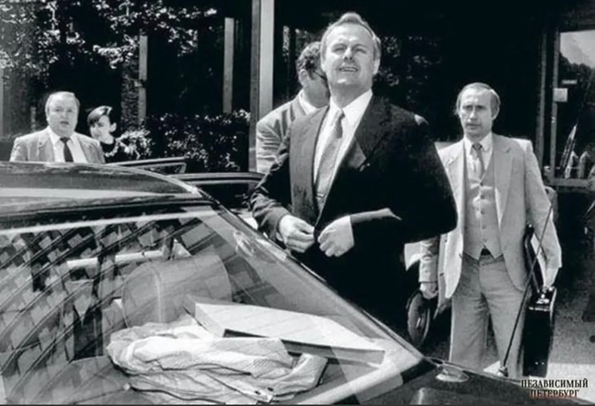
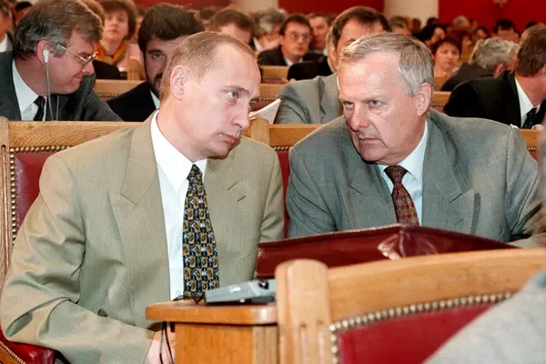
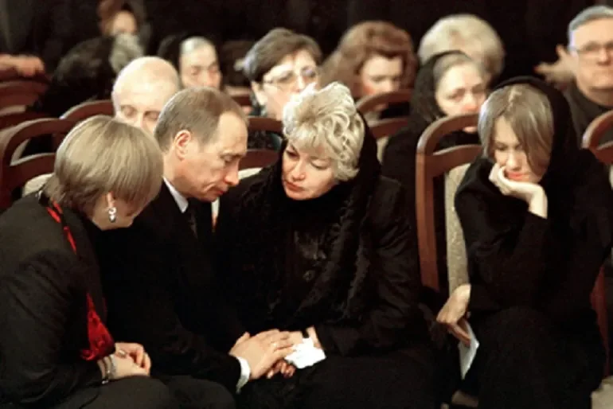
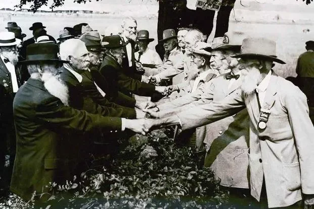

# On the Virtue of Vladimir Putin

**Author:** Kamil Kazani 
**Date:** 2025-08-09 
**Source:** https://kamilkazani.substack.com/p/on-the-virtue-of-vladimir-putin 
**Copied to Keg:** 2026-10-24 

---

Nobody becomes powerful by accident. Only the virtuous do. And the best, most conspicuous example you can see in the modern history is the career of Vladimir Putin. If you think about it, his rise looks like a pure fantasy, like a story from the ancient Chinese mythology. The emperor noticed an unknown, obscure, third-tier official, and elevated him out of nothing, and gave his empire away to him, solely and exclusively because of his shining virtue.

Now which kind of virtue did Vladimir Putin possess that the emperor noticed him, and gave him his throne, palace and power? He had something rare, so extremely rare, and so much more precious that mere intelligence, competence, or experience, or public standing. He had something unthinkable, something almost impossible to find, something the emperor most clearly could not find in all the others.

He was known as a grateful man.

***

You see, here is a problem with power. Like money, power is of course a blessing, and yet, a blessing that cuts both ways. Basically, it is also a curse, simultaneously. And one part of the curse of power is that you cannot just abandon it. Power is something you cannot really exit.

Like, in some countries, in some cultures, you can - to a certain extent. Some countries have a cultural habit for civility and moderation, have a taboo on unleashing political retribution against the defeated or disempowered opponents.

(I will cover this, when I will be discussing the Anglo genius, for it is the Anglos who managed to resolve this inherent problem of power better than anyone in the universe)

### But most cultures don’t

Most cultures have little to none taboos or institutional protections against the political retribution.

Now the absence of cultural and institutional protections - like the taboo on taking retribution upon your opponents under absolutely pretext, and for whatever reason - makes power in these countries something you cannot leave, nor abandon, even if you really want to.

Because the moment you leave the power, giving it to someone else, you will be stomped, and destroyed, and obliterated. You will be totally at the mercy of the one holding power now, and he will have huge temptation - he will in fact be under the great pressure to - to destroy you, and get rid of you.

That applies even to those cases, when it is you who empowered him, elevated him, or even appointed him as your successors. Because more often than not, the person you have elevated will behave as an ungrateful swine, and will have zero gratitude for all your favours and good graces showered upon him.

(In fact, there is nothing more common for a monarch than being destroyed by the very people he has elevated and showered with awards)

In almost all cases, the first instinct of the one who obtains power from your hands and through your good graces, will be to devour you in the moment the power transition is over.

Partly out of convenience, partly succumbing to the popular pressure, partly, perhaps, because the burden of gratitude is just unbearable.

These were the problems Yeltsin and his family were facing in the late 1990s

***

By that time, their situation was very damn difficult. Boris Yeltsin’s second presidential term was ending in March 2000 and he was constitutionally ineligible for the re-election. In theory, of course, he could throw the constitution into the trash bin, and declare some sort of a military rule. In practice, however, it would have been complicated to do.

First, by that time he was extremely unpopular, and increasingly so. His rate of approval was about 6%. The population in general hated and despised their president, and even more so, his “family”.

Second, and more importantly, his physical condition was getting worse and worse. He was already old and frail, losing energy, sharpness, clarity of mind. The medicines he was taking were incompatible with alcohol and yet, he was still drinking and drinking regularly.

His family who were increasingly ruling the country by his name had every reason to believe that should he die and be succeeded by someone else, his successor will direct popular wrath against them and basically just give them to the crowd. That he would do some performative show of justice, and buy a cheap popularity among the commonfolk, that loves when notables get stomped to the ground.

Like, the logical thing to do would be to choose a successor themselves, so that he would guarantee their safety. But again, there was every reason to believe that the chosen successor will do exactly that, will forget all their favors, and pay them back with the blackest ingratitude imaginable.

Because he would be subject to the same incentives as everyone else, and the favor is worth nothing, one it is done

*“The family”. The guy on the top left basically made Putin the president*

*“Roman is thinking of the Family. The Family is thinking of Roman”*

*That’s how political discourse of the era looked like.*

So basically your problem is. Your power is expiring very soon, your grasp over the state will be expiring too, you need to exist asap, and you cannot exit because the moment you do, you will become prey for the most terrible retribution. The only way out you can think of is to find someone who not only can but actually will guarantee yours and your family’s safety, when nothing really induces him to, except for the pure gratitude.

The task is difficult, almost impossible

***

And finally, Yeltsin found one.

Putin used to be an obscure regional official, a deputy of St Petersburg mayor Anatoly Sobchak. With Sobchak losing elections in 1996, Putin lost his job and was basically thrown out to the streets. Soon, however, he managed to get a job in Moscow, via his St Petersburg connections, that is through the network of another St Petersburg official, Anatoly Chubais. Basically, Chubais recommended him to the new head of Yeltsin’s administration (and simultaneously, Yeltsin’s son in law), Yumashev, who was a key and central part of the “Family”.

And once Putin got his job in Moscow, he used it to help out his former chief.

When the defeated mayor of St Petersburg became a prey for the criminal prosecution - again, you cannot just “exit” power, for in the moment you leave it, or lose it, you will be stomped over and destroyed - he was abandoned by pretty much everyone, except for Putin. His former deputy, now in presidential administration, used his network and his influence, to save his former chief and open him a green corridor out of the country. He basically allowed him to escape to France.

He overstepped his job instructions, and in other circumstances that might have hurt his career, and hurt it bad. But in this particular set of conditions, it worked out differently. The escape of Sobchak marked not the fading away, but the meteoric rise of Putin, from the unknown obscurity to the heights of power.

November 1997 - Putin helps Sobchak to escape

March 1998 - Yumashev appoints him as his first deputy, and the second most powerful man in the administration

May 1998 - again, Yumashev persuades his father in law to appoint Putin as the director of state security

(by that point, Yeltsin already decided to make Putin his successor)

August 1999 - Yeltsin appoints Putin as the acting prime minister

(by which point, he is still totally obscure and unknown to like anyone)

December 1999 - Yeltsin resigns and leaves Putin as the acting President of Russia

That’s it, basically

***

Today, it is very difficult for us to even imagine how unthinkable, how incredible was the rise of Putin, to like everyone, including to everyone in the Russian ruling elite. Everyone was just shocked, amazed, remained in total disbelief until the very last moment. Not only the foreigners were stunned, trying to understand who is that guy even is, but the members of Russian ruling class themselve. It was just difficult to conceive that Yeltsin would hand his country to like an absolute total noname

Let me quote you an episode from an amazing book, the Age of Berezovsky, that I strongly recommend you to read. Basically, it is a Russian oligarch Petr Aven interviewing other members of the Russian elites, building something like an oral history of the Russian 1990s, centered around the figure of Boris Berezovsky

Beautiful and amazing

So, Voloshin - the head of Yeltsin’s administration as of 1999, and another major figure of the “family” is discussing a meeting between Yeltsin, and the President of Tatarstan Shaimiev that took place somewhere in late July 1999, few days before the appointment of Putin as the Prime Minister of Russia. The context of the meeting was that Shaimiev allied with another potential successor of Yeltsin (Primakov), and Yeltsin tried to talk him out of this alliance, unsuccessfully:

> Voloshin: Yeltsin continued to try to twist Shaimiyev’s arm but, wily politician that he is, Shaimiyev delicately zig-zagged away from the point. There was more desultory conversation for five, 10, 15 minutes, but no breakthrough… Eventually, I could see that Yeltsin was starting to get angry because he wasn’t succeeding. Not only angry but thinking something out with deep concentration, thinking, thinking, thinking. I don’t think he was listening to what Shaimiyev was saying with any great attention. After some more thought, he interrupted his guest: “Mintimer Sharipovich, there’s something I want to tell you, but it must remain between ourselves. You’re a wise man, and when you’ve heard it you must act as you see fit”. And so at the end of July 1999, Boris Nikolayevich says, “Sometime soon I shall dismiss Stepashin’s government and Vladimir Vladimirovich Putin will become prime minister of Russia. In due course he will be President of the Russian Federation. That is what I wish to share with you”, announced Boris Nikolayevich, rising from his seat. “I wish you all success, Mintimer Sharipovich”. Then he shook his hand, turned on his heels, and left the room.
> 
> Shaimiyev was utterly discouraged by what he had heard. We went out of the wooden house in Gorky to the circular drive outside the front entrance, and Shaimiyev took me by the arm and said, “Let’s go for a walk, Alexander Stalyevich”. “Yes, let’s do that, Mintimer Sharipovich”, I replied. “I have a great respect for Vladimir Vladimirovich”, Shaimiyev continued, “but nobody knows him. It’s quite impossible! How can he be prime minister and then president? But it’s quite out of the question! I have the greatest respect for Vladimir Vladimirovich and also for Boris Nikolayevich, but that simply cannot be!” I replied, “Well, history will decide whether it can or cannot. The president has told you of his political intentions and shared them with you in confidence. Life will reveal to us in due course what transpires”.
> 
> Aven: Did it have much effect on Shaimiyev’s future actions?
> 
> Voloshin: Not immediately. I don’t think he ever believed it. He may well have thought it plausible that the present government would be dismissed and Putin appointed premier, but not the rest of the plan.

Do you see what is happening? Yeltsin is basically bruteforcing everyone to accept Putin as their next President, but even when he throws it into their faces directly, they still find it hard to believe. Like, yes, I have great respect, but how can he be a president if no one knows him? Utterly unbelievable. Still, Yeltsin is going on, and bulldozing, and suppressing every resistance, until every resistance is broken and the choice is made.

Yeltsin basically handed Putin the country, forcing everyone to bend the knee to Putin, and there is absolutely no chance and no way Putin could have become the president otherwise. The only reason he became one, because Yeltsin, and his family, and the entire clan worked to transition power to Putin 24/7, warning, and bribing, and threatening, and blackmailing everyone to submit. For they made their calculation and decided this is the man who is not going to betray them.

***

And they were right. They were absolutely right, and their calculations were right, too.

For the first act of Putin as a president was granting legal immunity to Yeltsin’s family, immunity he never infringed. They were given safety from retribution and prosecution, they got nice fat sinecures to live and feed from, they got everything they wanted. Meaning that their choice and their plan was totally correct, and very smart.

They chose a grateful man, and their choice has worked out marvelously.

***

Putin is grateful. And yet, there are limits and measure to his gratitude, for there’s a measure in all things made. It is not infinite. It knows limits, and its knows boundaries, as his former chief Sobchak would soon find out.

Sobchak was exhilarated when he learnt that his former deputy is becoming the president, and his friends - the former administration of Sobchak are getting appointed to all the positions of power and influence over Russia. He wanted to have a place in this new regime, in this new administration, so he flew to Russia immediately.

And just as immediately, he started fucking with his former student.

He broke the code of conduct, addressing him by his first name. And you should never address him a president that. Correct way is to call him by the name and patronymic, Vladimir Vladimirovich, in the most formal and ceremonial manner possible.

Calling him by first name would be worse. Highly inappropriate

Sobchak, however, did something more horrible than that, he addressed Putin with diminutive (Volodya), and did it publicly. That was unthinkable, incomprehensible. That is like calling the POTUS “Donnie”. Not a good look.

He tried to lowkey command him around, was giving him advices, reading him lectures, doing it publicly before everyone.

Perhaps, he found it difficult to just bend the knee to his former student, and he tried to show his power, and his influence, at the expense of Putin.

It is quite possible that Putin got tired of all of that, his patience was running thin.

Anyway, less than three months after transition of power to Putin, his ex chief died.

*Putin at Sobchak’s funerals, expressing condolences to his widow*

So what would be the lesson in all of that?

Why was Yeltsin treated so differently from Sobchak?

Why did Yeltsin get nice & shiny retirement and protection, while Sobchak was got rid of?

As in other cases, no one can answer these questions better than Italian political thinkers. My most reactionary belief is that Italian Renaissance thought is criminally underrated, for it is the best. Let me quote Guiciardini, Counsels and Reflections

> When you who were the beginning of my greatness or helped me in my rise, require me to govern as you please or to concede you powers in derogation of my authority, you cancel your original benefit, since you seek to deprive me, either wholly or in part, of the fruits of what you aided me to gain.

The difference is quite clear.

Yeltsin rose Putin out of nothing and stepped away. He got showered with gratitude in return.

Sobchak tried to infringe on Putin’s authority, diminish his prestige or even, potentially, question his leadership in the gang. He was disposed of.

There are limits to the gratitude, for the are limits for anything on the earth. To exit the power safely, you have to actually step down and walk away. Half measures are not going to work.

***

The problem of power, and the curse of power, namely that you cannot really exit it, nor step down without compromising your safety is extremely common, cross cultural. You find the same situation around all countries, all regions. And this, in fact, may be the singe least appreciated factor in the demise of democracies and change of powers. It is not only that the rulers are ambitious, it is also that they just don’t have a choice of stepping down and walking away. Very, very often they can either go up, or down into the prison and grave, and there are no alternatives to that whatsoever.

If I were to name the single culture that did the best job in dealing with this curse, it will be the Anglos.

In the next chapter, we will discuss the Anglo genius, the virtue of civility and moderation, of self restraint in a victory, and grace to the vanquished, that played a major role in stabilising the Anglo political landscape, and served as a remedy from spiralling into the wars of extermination.

