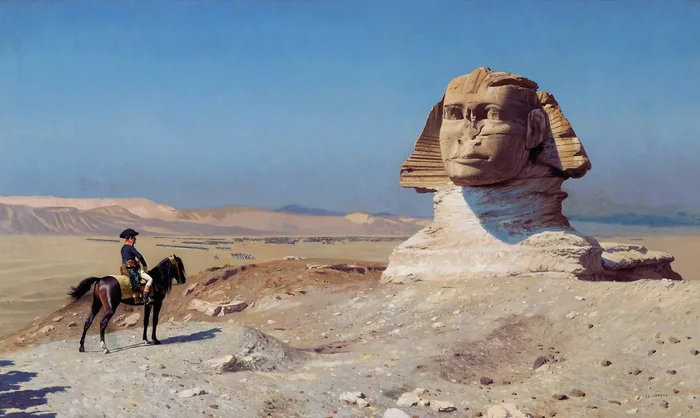
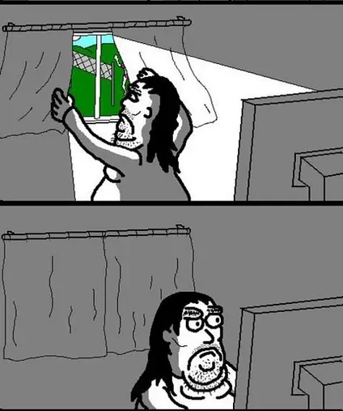
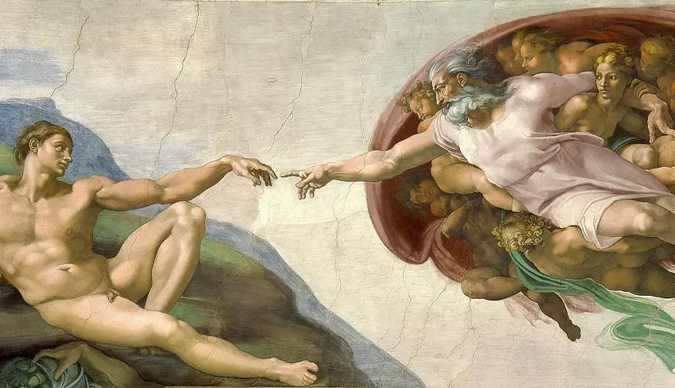

# Power and Glory

**Author:** Kamil Kazani 
**Date:** 2026-11-20 
**Source:** https://kamilkazani.substack.com/p/power-and-glory 
**Copied to Keg:** 2026-11-20 

---

When fighting his campaigns far away from the mainland France, Napoleon liked to assume the presence and manners of a king. In Italy, he held a court styled very much in royal manner. In Egypt, he enjoyed when locals addressed him as a sultan (‘Sultan el Kebir’) and lowkey encouraged them to.

### But not in France

In France he took an opposite demeanour

Upon his return from Egypt, he faced cheering crowds greeting him as a hero. A conquering general, super popular, clearly liked by the mob. And there were crowds, crowds everywhere: in every city he passed, there were huge gatherings of people, completely spontaneous, unannounced. They were usually led by local notables, mayors, leaders of the administration, who all wanted to see Bonaparte and warm in shines of his glory. Everywhere he came, he would be treated as a superstar, and greeted by thousands.

That is why to Paris, he came early in the morning. He entered the capital of France at 6am, on the 16th of October, 1799. That is, more than two hours before the sunrise. He took special care to enter the capital in darkness, and in cold. When there will be no one in the streets except a few workmen hurrying to their jobs, too busy to pay attention.

Why? Well, the answer is obvious. Because he was determined not to have any cheering crowds, not to have any thousands of Parisians shouting his name, and most certainly, not to face any delegations of notables, military and celebrities showering him in their praise and gratitude.

Again, why? After all, he is the super popular general, overall, the most popular in France, while the government is hitting the low of its unpopularity, being almost universally hated and despised. (That is a major reason why being, theoretically, a parliamentary regime, they have to do new and new coups, to bypass, or correct the electoral procedure. They know they are unpopular and cannot be reelected normally)

Still, Napoleon knows something that many tend to forget. He knows that any government, however rotten, despised and unpopular is still ten thousand times stronger than any other guy in the country. Collectively, they are a giant, and he is a bug. And, should he alarm them, they would crush him, like they would do with a bug. Should he provoke their fear and jealousy, they would just kill him, and then get away with that, and he will be forgotten real soon because it is real life and not a fairy tale.

Which is exactly why he takes special care not to provoke their fear and jealousy. He enters Paris in the darkness and cold, two hours before the sunrise. He shuts himself in his home, refuses to see anyone, denies all the invitations go give orations and attend celebratory ceremonies. All the visits from the military and officers are promptly rejected: he does not want to have any delegations centering him and paying him their respect, as it had happened in Lyons and Avignon.

When it happened in province, it is not good. Should it happen in Parish, it will be absolutely catastrophic. It can be the end of it.

So, he just sits at home, refuses to see anyone and has no social life

*Napoleon upon his return from Egypt*

Now when he finally gets out from seclusion, he starts hanging out with academicians, intellectuals, and men of letters. He most clearly wants to create an impression, of a not worldly man, more interested in science, and in scholarship rather than in politics.

And only then, having finally soothed, and calmed down any suspicions of his political superiors, he finally comes out from his cave for good, and starts hanging out with everyone, including practical men, military and the politicians. And it is at this point that he starts receiving tons and tons of offers to participate in this or that political project (or conspiracy). Because again, the regime is weak, the regime is divided, it is internally unsteady, and there are tons of political entrepreneurs wanting to fish in these muddy waters. And many of them would want to have Bonaparte in their ranks.

All of these offers, he rejects

He is not going to put his fame and reputation on a stake in some stupid aventure guaranteed to end with failure. He is way to smart for that.

And the offer he finally *accepts* does not come from just some political entrepreneurs of adventurists. <u>It comes from Sieyes</u>, one of five members of the Directory ruling France at this point in history. It literally comes from one of the top leading figures of the regime. And it is not until having received and offer (and passed an interview) with one of the top regime leaders, that Bonaparte starts his coup preparations.

To put it in very simple terms, Bonaparte does not even think of staging any kind of coup,

### Until the government commands him to do it

No offer, and no political adventure would ever entice Napoleon unless it came from the very very top. From the literally a member (well, two members) of the government itself. Only at this point does Napoleon start his work

And that is because he understands a simple truth many forget:

### That it is nearly impossible to overthrow a government unless the government invites you to

The coup is generally possible only by invitation (and with cooperation) of the uppermost government and will disintegrate into pieces if this cooperation is denied, or fails to materialise

So what did we learn from the character of Napoleon from this short story?

We learnt that he was, in the end, a very sensible and realistic man with good understanding of his strength and his weaknesses. That he never forgot that he was, in the end, only a man, and, as a man, vulnerable. Cheering crowds, praises of everyone, delegations of military and officials addressing him as almost a head of state did not turn his head or cloud his vision. He not even for a minute forgot about the actual balance of power: and that the most popular general in France will be crushed by the hated & universally despised government like an insect, and will be instantly forgotten, should he do anything stupid, like making the government feel threatened or alarmed. Hence, all his extreme effort not to alarm the government, and keep an extremely low profile, especially in their presence. It is in the province, or overseas that he can play as a king. In Parish, he should not even think of it, or he’s dead.

Hence, entering a capital before the first rays of the morning. He knew very well what he was doing.

And this, indeed, teaches us a lot about Napoleon’s character. We see that he was, in the end, a very special man. A genius of war, a genius of propaganda, he knew when to turn off all the propaganda and lay low. And that is because he had a superpower to **not** be carried away by the popular sentiment. Cheering crowds, and media praising him as a divine.

Because in the end, he remembered, his was only a man