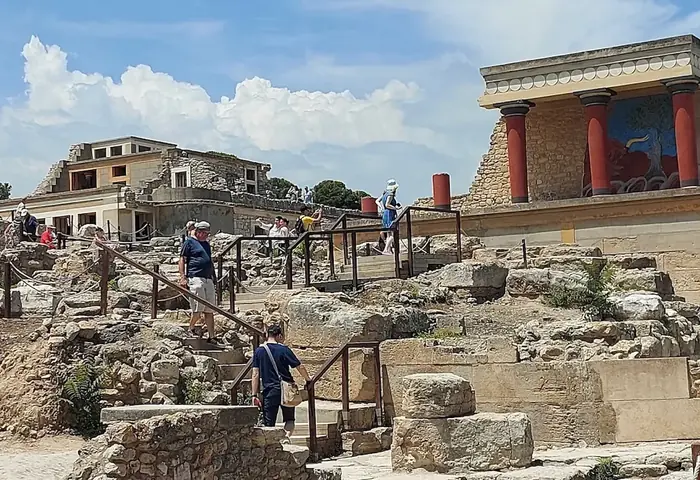

# Why sanctions produce the opposite effect to what they had intended

**Author:** Kamil Kazani 
**Date:** 2026-11-13 
**Source:** https://kamilkazani.substack.com/p/why-sanctions-produce-the-opposite 
**Copied to Keg:** 2026-11-13 

---

I cannot think of a single example of "sanctions" producing regime change, anywhere

In fact, I incline to think that sanctions tend to buttress regimes they are directed against, stabilise them and make the more internally robust

Here is why

The purpose of sanctions is to torture the weak

Government is not that weak

Almost any government in the world is many orders of magnitude more powerful than all the other actors in the country combined.

What that means is that under the pressure, including the economic pressure, the royal palace will be the last to crumble. In fact, based on all the previous record, you can expect that the palace will not crumble even when everything else does.

(I would, personally, bet my money on that, every time)

Now what that implies is that under the pressure of sanctions **the entire national economy is reducing into a palace economy.** You can think of Minoan Crete, Mycenaean Greece, or of the ancient Mesopotamian polities.

The overall size of the economic pie may be decreasing (it usually does), but the share of the palace in that pie, increases. And, as the independent economic life dies out, all that remains is the state run contour directly managed from the palace, and the pile of rubbles around.

### What that means is that all the independent centres that might challenge the palace at some point (with a varying degree of success) die out.

No independent sources of income exist anymore. No independent playfields. Increasingly, **the only way of survival** (and certainly of prosperity) **is getting allocated some barley from the palace granaries**. The only people who eat, are those who got allocated some barley. That means there is nothing one won’t do, to keep receiving his bowl of barley. That means that one must remain in very good relations with the palace, under any circumstances. **That means that the only economic or labour activity worth doing is providing valuable services to the palace**, or those that the palace deems valuable.

That means that as all other sectors of economic life crumble, the stability of palatial contour will buttress and improve, **even if it does not look like that from the outside.** From the outside it may seem that the payment is meagre (barley), plus it may not be even very good or fresh barley. But from the inside you understand that it is either this bowl of barley, or starvation. **And this bowl of barley is invaluable, because there are simply no alternatives left.**

What sanctions do, **again, and again, and again, is destroy any alternative means of existence,** and economic playfields, that would allow one to live, grow and prosper, even without being is particularly good relations with the palace, or providing services to it. **All that remains, is royal service**, and service to the state, that faces no competition anymore, as every sector it had to previously compete with (for labour, for resources, for loyalty) had been strangled or burned to the ground.

As the economy is being reduced, and social structure primitivised, the overall domestic security and stability of course improves. Primitive, reduced social structures tend to be surprisingly robust, beating almost everyone’s expectations. As a general rule, they don’t face much political threat, unless to the direct foreign conquest (with the boots on the ground, military occupation and such). Otherwise, they just stand, and keep standing, under the bombs, famine and shortage of everything.

How do they collaspe then? Can a primitivised, reduced, palatial-centered political and economic structure just collapse from inside, in the absence of a successful foreign invasion? Yes. The answer is, yes. **It can, if it is trying to improve.**

As long as a palatial society remains as such, it stands as a rock, invulnerable to all the domestic and most of the foreign threats. But the moment it is trying to improve, loosen the reins a bit, allow more independent economic, intellectual, or political activity, it is becoming extremely vulnerable, and extremely wobbly. **As society becomes more complex, sophisticated, and rich, it becomes more difficult to manage**. That means that the previous elites, and previous administrative structures, may just lose control over what is going on.

The old (and relatively primitive) governing subject can no longer maintain its grasp over an increasingly complex and independent-minded governed object. And, unless it reduces, lobotomises, and emaciates the governed object, bringing its degree of complexity back to the manageable level, the governing subject will have to go.

***

The picture I have painted may look unfair. Bad regime stands like a rock, but the moment it starts actually becoming better, things tend to implode. Bad state of affairs can continue more or less indefinitely, but the moment things start improving, the whole structure becomes increasingly wobbly. In practical terms that means that if you want to “freeze” the current balance of power and influence, best thing you can do it to consciously keep things bad and not allow them to improve. If you do just that, you are likely to have a long and happy reign, longer and happier than if you actually cared of your people. Which, indeed, sounds sort of unfair.

But the world is not fair