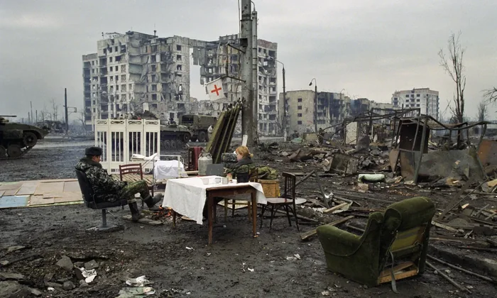
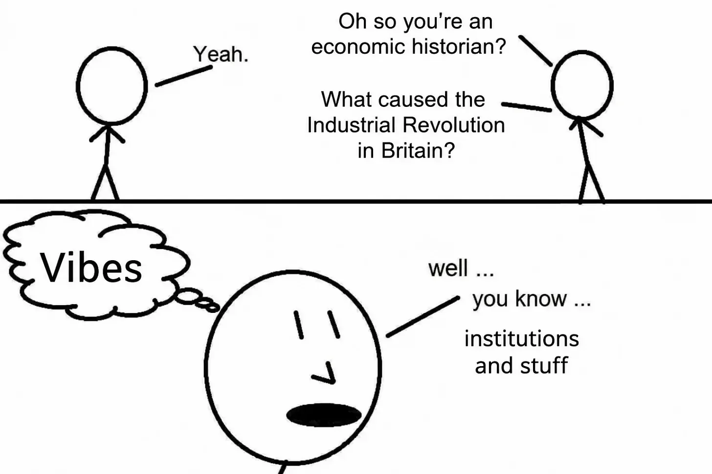

# Why did not Russia become a democracy?

**Author:** Kamil Kazani 
**Date:** 2026-10-31 
**Source:** https://kamilkazani.substack.com/p/why-did-not-russia-become-a-democracy 
**Copied to Keg:** 2026-10-31 

---

I have been recently asked: why did not Russia become a democracy like (many) Eastern European countries did after 1991?

At the first glance, it may sound like a silly question. Like, why should it be a democracy in the first place?

On the second thought, however, I started thinking that it may actually a good question to ponder about. And that is because it is not so much a *question, as a statement.* And a statement, containing a significant element of truth in it.

Yes, indeed, after the disintegration of the USSR, trajectories of the post-Soviet societies branched off. Some of them built a freer and more pluralistic political system. Some of them, did not.

One would be tempted to explain everything by ‘culture’. Well, I don’t like this particular kind of explanations. Part of the reason is that they are too tautological. That is like explaining economic growth by ‘institutions’. Institutions produce growth, and the growth happening means that the institutions are alright.

Sorry, it’s a vicious circle down there

Plus, I don’t think it’s just about ‘culture’

Comparison with Ukraine can be especially helpful. That is because these two cultures are extremely similar, extremely compatible and tend to share exactly the same brainworms.

(*Just few days ago, I talked with someone from Kyivan intelligentsia. An interesting, well-educated and a comfortably upper middle class person. 100% patriotic, and 100% anti-Russian. Now every time, our conversation touched literally anything apart from the Russian-Ukrainian conflict, I would find myself thinking: but I’ve already heard, heard all of these talkpoints. I heard them on the kitchens of Moscow. Everything he believes in, exactly, 100% matches with what a person of his education level, income tier, and age, would normally believe in Moscow*[^1])

Still, despite having an extremely similar culture to the Russian one, and sharing an extremely similar set of opinions, Ukraine managed to build a political system which, despite its innumerable flaws, is considerably freer and more pluralistic. For example, in Ukraine supreme executive power actually changes as a result of elections. In Russia, it simply never happened, not even once in history.

The question is why.

Corruption, comically rapacious, extractive oligarchy, low trust culture, all of these evils are very much present in Russia. And yet, they are also present in Ukraine, and to a similar degree. Still, the Ukrainian political system is freer and more pluralistic.

So, it’s probably not about corruption. There must be something else.

I think I can give a better answer than just "vibes”[^2].

There are three major lessons one can draw from Russia, which apply to, well, anywhere in the world:

**1. Empire is incompatible with Republic.** 

Owning an empire and remaining a republic is, in the long run, impossible. These two things are incompatible with each other, and incompatible everywhere: in Rome, in Moscow, and in Washington DC. Every single instrument you use to control the periphery will be applied in the metropole as well, with the 100% certainty. Imperial boomerang is coming, and the import of imperial institutions back home undermines every element of political freedom you may have.

(Many Americans feel it with their skin, even if they cannot explain it logically. That is the major reason the American public opinion, in general, is highly suspicious and mistrustful of their own empire. Deep inside, they know, it is not going to end well)

In Russian context, that means that the main mechanism behind the dismantlement of every single element of political freedom in the country had been the Chechen Wars, and the institutional blowback they produced. One particular element of that blowback was the enormous growth of security services, and normalisation of rule by state security, which, quite naturally, transitioned into the rule of state security.

Which brings us to our second point.

**2. Intelligence must be a slave, or it will be a master** 

Intelligence, security services are either a master, or a slave. There is no in between. This is the universal law that applies to democracies and autocracies alike. Security services must be kept down, because otherwise they will rise too high up, and, in the end, take over. And they should not take over, because their professional deformations will make them strangle any organic growth, and any organic development in the country.

(*Out of the best possible intentions, of course. Anything being done, is always done out of the best possible intentions*)

And the remedy to a takeover by state security is pretty straightforward. They must be treated as slaves. Lowly, dishonourable, sweeper-like job. Social outcasts, Much like torturers and executioners were treated in the Middle Ages. Yes, the city employed them, but it never thought to celebrate them, or show their faces. They were denied any public recognition, and electing them as the magistrates was totally unthinkable.

(The major reason state security never took over China, for example, like it did take over Russia, is that in China it was treated as a slave, kept low, denied any fame and any glory)

Which must be the rule today. Any participation of the intelligence operatives in the electoral politics, for example, must be barred. Medieval townsmen would never coopt the butchers into the town council, and neither should you.

**3. Separatism breaks path dependency to a far greater degree than revolution** 

I have been talking to a friend, and he asked me whether there even are examples of revolutions that did not end in an usurpation, dictatorship, and some form of return to the old order, but rather produced a greater degree of political freedom that exited beforehand. I said, yes, certainly. Think of American Revolution, or a Dutch Revolt.

The shared quality between the two, that these two were not so much revolutions (one government overtaking another), as separatist revolts, in the faraway provinces. Americans and the Dutch did not aim to take over London and Madrid respectively, but rather build their own government, anew. In that regard, they broke with pre-existing path dependency to a far, far greater degree than either the English, or the French or the Russian revolutions could.

In England, it all ended with restoration of monarchy. In France, their Bonaparte emperor ended up restoring the rituals of Bourbon monarchy, even in a clumsy and grotesque shape. And even in Russia, the Stalinist regime ended up returning to the Kingly aesthetics, to the shock and despair of the old Communists.

In America, like in the Netherlands, there was no turning back. That is because separatism breaks path dependency more efficiently than a revolution. And, indeed, what the American example shows is that you can build a very different political organism even from the very similar human material as the one of the old metropole.

Which is, perhaps, also one of the lessons of how the Russian-Ukrainian institution broke.
---

## Footnotes

[^1]: Part of the explanation, of course, is that his opinions, have been borrowed from the very same set of bloggers and podcasters, as the Moscow intelligentsia is listening to

[^2]: There is nothing wrong with a vibes based explanation, except it’s unclear what lessons to draw from it, how it applies to other cases and, honestly, even to this particular case we are talking about. Like, ok, vibes are bad, I get it. Now what.