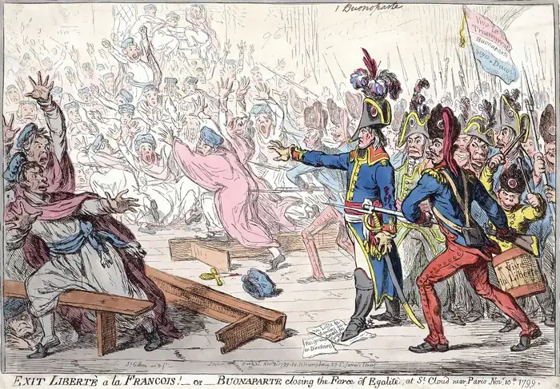
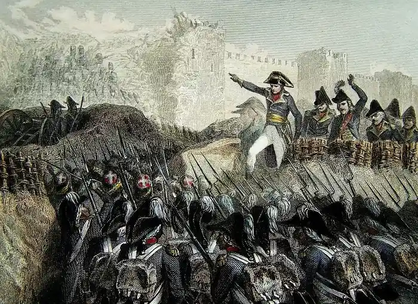
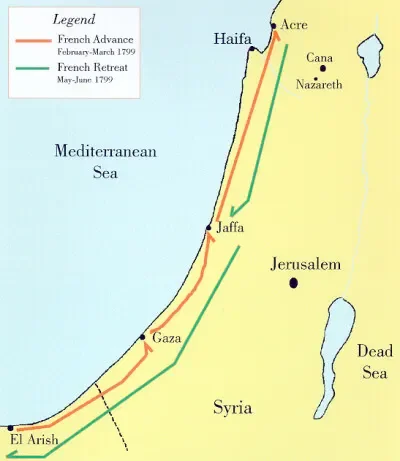
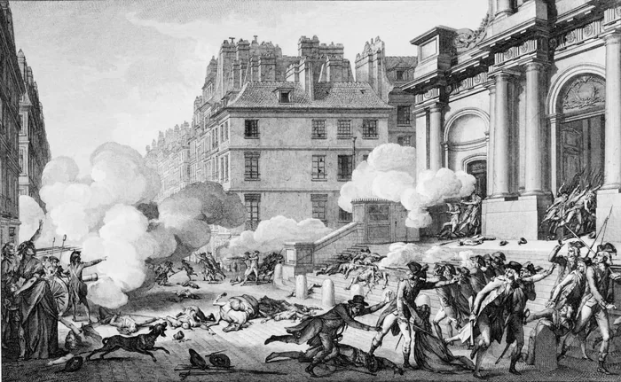
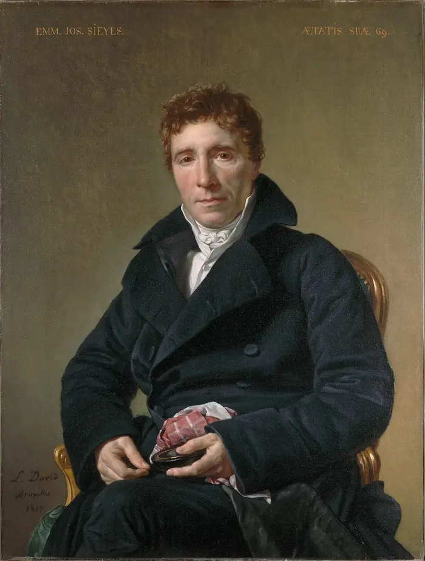
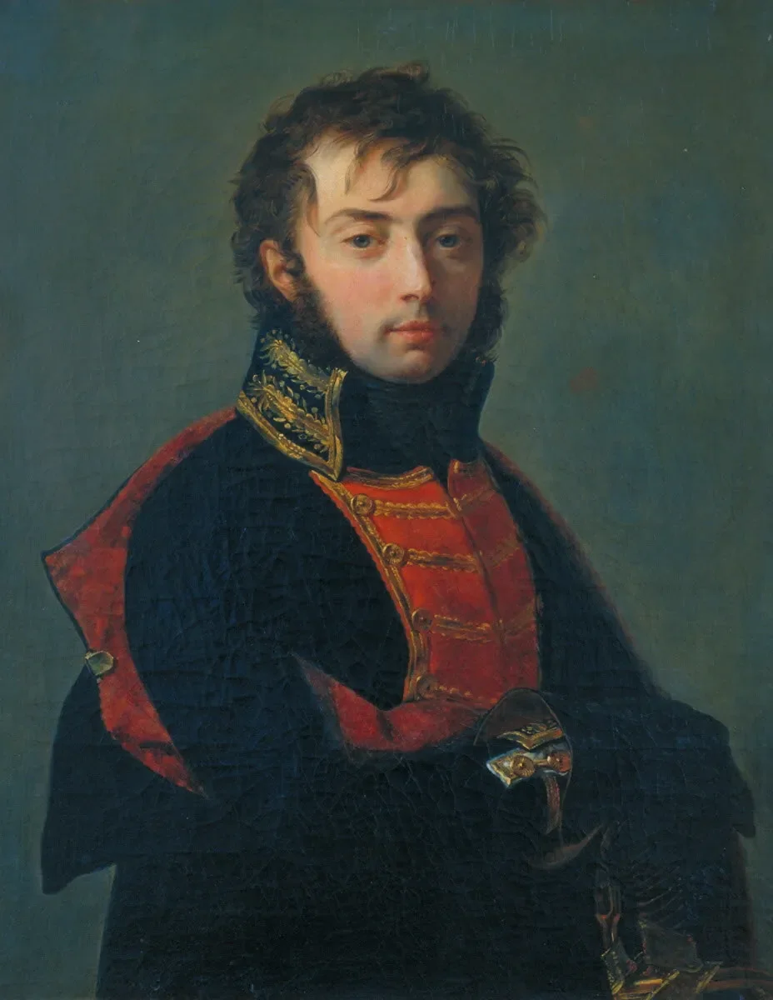
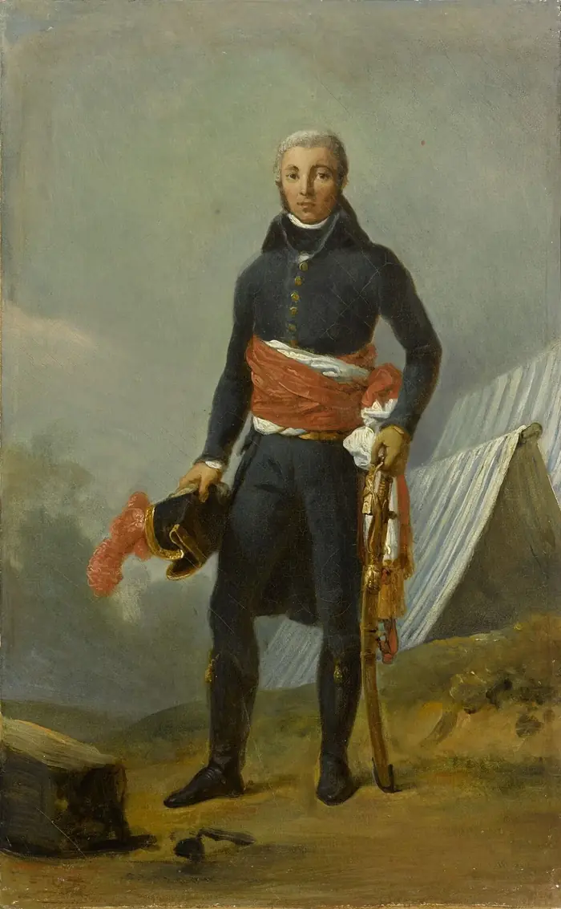
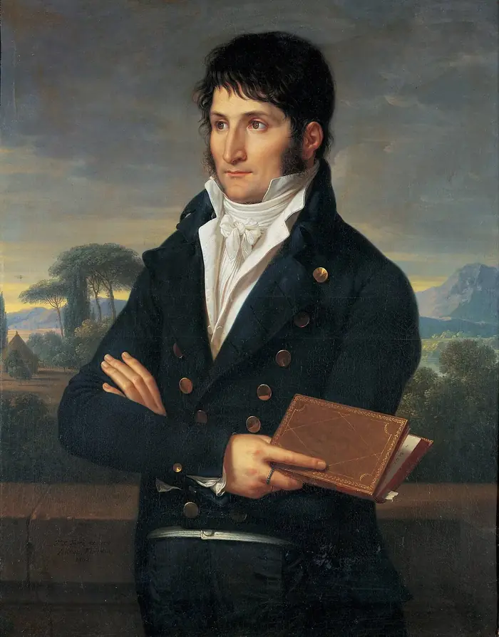

# How to make a coup

**Date:** 2026-10-16 
**Author:** Kamil Kazani 
**Source:** https://kamilkazani.substack.com/p/how-to-make-a-coup 
**Copied to Keg:** 2026-10-16 

---

How did Napoleon come to power?

Were I to summarise the popular view on that, I would put it in the following way:

In the late eighteenth century, France was run by the corrupt, deeply unpopular regime of the Directory. And yet, it had a brilliant general who was winning battle after battle, in Italy, Egypt, Syria. Upon his return from the Middle East, the victorious hero finds his country in a complete havoc. So he rallies his loyal grenadiers, throws out the corrupt politicians, and seizes power by the armed hand.

That is a vivid, picturesque, and a highly persuasive image

Unfortunately, this image is false. That is not how it happened

This popular myth of Napoleon (also represented in the British caricature above) was selected for its *memetic fitness*, not for the truthfulness

And the truth, of course, is that Napoleon did not so much seize power, as it was handed to him, by the current rulers of France

And that is important, because this - by and large - is the most realistic scenario of coming to power, on the planet earth

You don’t breach the walls. You come through the open gates, opened by a faction within the regime. Power can very rarely be conquered, it is almost always delegated, delegated by those who already hold it. For you to come in, they must first invite you.

But once they do, it may be possible for you to seize more, much much more than what they had originally planned to offer

So now let’s talk of Napoleon

***

August 1799. Young general Napoleon Bonaparte sails back to France from Egypt. He is highly popular, crowds are cheering, praising him as a hero. Everything good?

Not quite

First, he is a smart guy, and understands how fleeting the human emotions are. Today they are cheering, tomorrow, they can be demanding his head

Second, not everyone is cheering. Crowds do, but the elites don’t. Military elites, in particular, are sceptical. Some are openly calling to reprimand him.

That is because other generals understand what has just happened:

### Napoleon has abandoned his army in Egypt

He ran away, leaving his troops behind

Now the thing is that even these sceptical generals do not know the full truth

Which is:

### The whole campaign turned out to be a catastrophe

Which is exactly why Napoleon fled

Now why do the crowds cheer? Because they base their opinions on the newspapers. And the newspapers base their articles on the bulletins & reports Napoleon had been sending from Egypt. For the most part, these bulletins contain shameless lies and just as shameless self-promotion, largely detached from any factual basis.

If the Egyptian campaign brought mixed results, the subsequent invasion of Syria turned out to be a bitter failure. Napoleon couldn’t capture Acre, and was beaten off with massive casualties. His retreat back from Syria turned out to be a small repetition of 1812, his scattered troops fighting their way back, leaving the wounded and the ill behind to their certain deaths.

*Multiple assaults on Acre brought no positive result at all. Napoleon’s deputy Kleber cursed the general “10 000 casualties a day”. Although this estimate may have an element of poetic exaggeration, the general failure of campaign was difficult to conceal.*

*The retreat from Acre (in green) was a rehearsal of the future Russian campaign. The French fled, leaving or, possibly, killing everyone of their own who could not march anymore.*

If the crowds in Paris are cheering, that is because they do not know the full situation, and base their opinions on the propagandist crap Napoleon had been sending from Egypt.

But they will, will very soon. As soon as the alternative reports from Egypt - written by Kleber - who hates the general 10, 000 men a day - reach France - Napoleon may find himself in a very, very difficult situation.

If Bonaparte is to convert his clout into something firm and solid, he has to do it now

Tomorrow it can be too late[^1]

That was the context of Napoleon’s situation in Autumn Paris, 1799

***

How did he mastermind his coup then, you may ask?

Well, he did not

He was invited into it

Other people - who were already in charge of the country - and wanted to execute a one more change of political decorations have masterminded it all, and, having masterminded it all, invited Napoleon to join them.

And why on earth would they do it? Why would they facilitate the transition of power to Napoleon Bonaparte, you may ask?

And the answer will be:

### Because they did not mean it

That is the crucial point almost everyone tends to miss[^2]

The French Revolution was personally triggered and spearheaded by the King of France Louis XVI

Why would he do it?

Because he did not mean it

The French Revolution was effectively ended by the radical Jacobins who conspired against Robespierre and all lost of their power as a result

Why would they do it?

Again, because they did not mean it

Great historical upheavals very seldom result from a mastermind plan going right

More often than not, they are a result of a mastermind plan gone wrong

Like Napoleon’s ascendance to power

***

Since the end of Robespierre, the political leadership of France has been facing the following dilemma.

On the one hand, they headed a constitutional regime that was based on the principle of electoral legitimacy. Why are we governing France? Because we represent the people of France, who expressed their will in the course of the general elections.

On the other hand, they could never ever afford to lose these elections, not even once. And that is because the new republican regime lacked any checks or balances, lacked any mechanisms of protection. Should you lose to wrong people, you will be totally, absolutely at their mercy. And you are better not to be at anyone’s mercy in a country that has no checks, nor balances.

Which means:

Every time the ruling clique felt at risk of losing power to the wrong political forces, it “corrected” the electoral mechanism, by force.

And how exactly did they correct it?

### By sending troops

And indeed, they sent the troops in, repeatedly, consistently.

And by doing so, they would gradually invite the military into power.

Step by step, iteration by iteration, with every military intervention into the politics, the military were becoming less of a tool, and more of an independent actor. Less of an instrument, and more of a master.

Only the politicians were not realising it

***

How did Napoleon himself gain political influence for the first time?

By helping to correct the electoral mechanism by force

In 1795, the ruling oligarchy passed the law of two thirds. Basically, it meant that instead of re-electing the National Convention (holding the sovereign power over the country), they would pass two thirds of the old deputies into the new convention, and would actually re-elect only the one third of them.

That law has sparked much controversy, and has in fact triggered a revolt in Paris.

To quell the revolt, one of the leaders of the regime - and the supreme commander of its troops - Paul Barras, decided to employ the military. And yet, the current commander of troops in Paris showed strange and suspicious hesitation in dealing with rebels, negotiating with them rather than just using force. That was very dangerous, super dangerous. That is in fact how you can plausibly lose power to a mutiny. Your own commander fence sitting and waiting to see what happens.

So, Barras decided to throw him out and find another, more loyal and more controllable guy to drown the revolt in blood.

And he found him. That was his long time no see acquaintance he met when suppressing a rebellion in Toulon, some years ago. A young artillery general Napoleon Bonaparte who at that time was stuck at the dead end job in the topography bureau, and saw zero career opportunities in France. He was actually plotting a transfer to the French mission in Constantinople, where he hoped to get a commission into the Ottoman Army. That was his career plan at the moment Barras remembered him and called him back to the active service.

Unlike his predecessor, Napoleon showed zero hesitation in using the force against rebels and scattered them with cannonfire. The revolt was quelled, the government was saved, and grateful Barras appointed him as his next in command over the Army of Interior quartered in the center of France. That is where his steep, meteoric rise begins. For that to happen, he had to make himself useful for the existing power.

***

Notice that Napoleon’s rise to power did not start from any posturing as an “independent” figure in politics. No, not at all. It started from exactly the opposite. It started with Napoleon becoming something like a junior associate in the ruling cabal, a part of the broader network of patronage.

Now let’s recall for a moment what we have already learnt about the nature of power. Power is not exercised by the individuals, nor of course, it is exercised by the institutions. Power is exercised by cliques, by the informal webs of patronage and vassalage. The network consists of Jean, Paul, Joseph etc etc etc, and collectively they, all of them, are exercising power over well, anything

The surest way to gain power, is to be invited into this network, in a junior, associate role. Then, starting from this lowly position, you can gradually increase your role, and potentially reverse the original balance of power. Joining it as a servant and then becoming the master is much, much more realistic than doing it all independently.

And what you need to join the cabal, is to becomes useful to it in some capacity. How you can be useful, that is another question. In Napoleon’s case, it was his military capability, combined with his readiness to execute his masters’ orders, no questions asked. Starting from this lowly position, he would gradually work his way up. But the original act of joining the cabal was absolutely necessary, for his career.

What is important here, is that in 1795, he joined the clique of Paul Barras, and from this point was known as a capable and reliable servant, who would do the job delegated by his political superiors, no matter how bloody or how dirty. That gave him his initial political capital, and his major appointments in the army

(When appointed as the commander of the army of Italy, he was initially met by the scepticism of other generals, who saw him as a political appointee. And they were absolutely right about that. He was)

***

In the following years, the ruling oligarchy continued to face the very same dilemma. The basis of their legitimacy was based on the elections, yet they could never afford to lose these elections, not even once. As a result, they were forced to play the same trick again and again, every time more and more shamelessly.

Again and again, they had to resort to the direct, unmystified use of military force, sending the troops against their political opponents

### That is how they facilitated gradual transition of political power to the military

And that is the problem of ruling by sword, or sitting on bayonets

Every time you use them, you become more and more dependent on these bayonets

Every time you use them, you transfer a bit of your power to these bayonets, who gradually acquire more and more agency, and need you less and less

Transition of political power to the military does not happen in one day

It happens bit by a bit, iteration by iteration

The military do not so much overthrow the civilian government as are being (gradually!) invited to the power by the civilian authorities

### Like the devil in medieval legends, the military can come into power only by invitation

That is why wise political regimes avoid giving the military any invitation to expand their role in politics

> That, for example, is a major reason why Russia still runs elections. They very much prefers fake and fraud to sending the bayonets in

The French Directory was not so wise

***

That was the time, and that was the context for where the preparation for the coup started

Who started the coup, you may ask?

First thing to know is that,

### Napoleon was not the initiator of the coup

He wasn’t an instigator

It wasn’t his plan

The primary mastermind behind the coup was Abbé Sieyès

Who was Sieyes?

He was one of the five Directors who actually ruled France back then

At this point in history, the government of France looked like that:

You have a parliament (National Convention) consisting of the upper & lower house

And you have a government consisting of the five Directors elected by the convention

A democratic, constitutional regime (or so it seems)

Reality, however, was more difficult

Regime was widely unpopular. France was a poor, starving country, impoverished by the war, and burdened by the weight of conscription.

Under these circumstances, the regime had to constantly defend itself from the attacks, from the left and from the right. It had to suppress the hunger riots, anti-conscription revolts, and rebellions in the provinces.

Even worse, it had to repeatedly “correct” the results of elections and the electoral mechanics to secure the right political balance

And that is when the military came to hand

Correction of the political balance was always done by the hands of the military

Time after time, the ruling clique sent out its pet generals to suppress mutinies, and to purge their own political enemies, often totally illegally & illegitimately

### Now Sieyes tried to do it again,

For that to happen, he needed a “sword”

A killer, a hitman, to do the dirty work for his political superior

All he needed was a general, ready play the role of a pawn

A reliable, efficient scheme that had been already executed multiple times before, and always worked.

So, Sieyes started looking for such a pawn

At first, he thought of general Joubert

But Joubert was killed in battle

Then he thought of general Moreau.

Moreau refused, but suggested another candidature: Napoleon

### “That is the man you need”, he told to Sieyes

(Notice, that in the future Napoleon will see Moreau as a rival, and kick him out of the country)

So, Sieyes reached out to Bonaparte, invited him for an interview, vetted him and chose him to execute a coup

Bonaparte did not prepare his coup in high secrecy (that is impossible). He was headhunted for the job by the higher ups and was only No. 3 candidate in their list. If it was not Bonaparte, Sieyes would just choose someone else

They paved his way to power, not intending it

***

Now let’s say a couple of words about the coup itself

There is a popular myth of Napoleon forcefully disbanding the legislature with his own loyal grenadiers

Not true, not true at all

The things with the National Convention of France is that it was *not* disbanded by the Napoleon’s loyal troops (as people falsely believe)

There was no personal army of Napoleon concentrated in Paris (in fact, great many of his loyal troops were left behind in Egypt). And even if there were, Convention had its own guard, completely independent from the military command structure. It had its own loyal grenadiers, who made its inner circle of defence

They are not loyal to Napoleon. For them, he is just another general

They are loyal to the legislature, whom are appointed to guard

In fact, many of them, may view him with suspicion and will certainly not follow any command of his

So, Napoleon comes out to these troops of the legislature, makes a speech

It does not produce any effect

(That he can't stay on his horse while making a speech does not help)

He enters the legislature, makes a speech there, and faces extreme hostility from the deputies. They shout at him, calling him a traitor, an outlaw. They propose to declare an emergency law

Napoleon faints away

He is dead. He is a dead man

As dead as Robespierre, before him

By that point he, and all other members of conspiracy are guaranteed to lose their heads. Everything is lost

So Lucien takes the word. Lucien Bonaparte, the younger brother of Napoleon, and the Président du Conseil des Cinq-Cents. Who is, of course, also a part of the conspiracy.

And that is a very important point. Because the grenadiers of the convention do not owe any loyalty to Napoleon. They do not even know this guy, and of course are not going to follow any orders of his. But they do know Lucien, and are used to see him as their chief, who gives them orders by the name of republic.

He goes out to the guards. Testifies his loyalty to the republic. Swears to kill his own brother (Napoleon) should he ever betray the liberty. Claims there are English traitors in the house, trying to kill the honest members of parliament

And then leads the un-suspecting grenadiers to clear off the house

Napoleon did not lead the grenadiers. He could not, because they would not follow

Their own chief, the legitimate leader of the political body led them, commanding the guards to disband the house by the name of republic. And they did

***

Now let’s go to conclusions

There is a Great Man Theory of history. Great man doing it all by the virtue of being great

There is an alternative, materialistic & deterministic view (it’s all about “socio economic factors”)

What I am offering is a bit more complex

The history is not so much driven by the individuals, as it is driven by the factions

By the cabals and gangs, consisting of living people, living individuals

What played the key role in the coup was a cabal

Sieyes - Lucien - Napoleon

It is the network that moves history

Network, running above the formal institutions, and weaponising them for their own purposes

An individual cannot do, or accomplish much, unless as a part of the broader network, a gang

Part of the reason is that a major accomplishment depends upon an orchestrated effort of many people. It is not just a lone genius doing everything himself. That’s not how it works. Many and many should contribute to the effort, for it all to work out

### But in the end all the glory belongs to one

And that is indeed what happened after the coup

The coup was initiated by Sieyes. Nothing would happen without his initiative. It was he who designed the plan, and it was he who chose Napoleon to execute it

The coup was won by Lucien. If not for his intervention, the coup would certainly fail, and both Bonaparte brothers would find themselves on a guillotine

What happened to them next?

Napoleon sidelined them all

He usurped all the glory to himself, and refused to share it with anybody, including his co-conspirators

They did not mean it, preparing this coup. They absolutely did not. And yet, that is what happened

As Ibn Haldun pointed out,

### Empire will not belong to those who conquered it,

### And the riches will not belong to those who earned them

Now let’s move further

There is an interesting thought of Peter Thiel that I want you to interiorise:

### Creating value and capturing value are independent variables

Basically, what it means is that you can create a lots of material value for everyone and get nothing of it. Happens all the time. And vice versa, you can earn lots of money without creating any material value worth of mentioning

Again, happens all the time

Now I want you to apply the same principle on a different field

### Contributing to an accomplishment, and taking credit for it are independent variables

In fact, taking credit belongs to the realm of memes, and memes are selected for their memetic fitness, not for their truthfulness

The actual story is nuanced, complicated, often ugly. It takes a lot of space in our brain

The story that wins must be bright, swift, and also - economical

Part of the reason all the glory will belong to one, is that this kind of interpretation is just.. simpler. “One guy did it all” story occupies less space in our brain, and is, therefore, more memetically contagious.

Also on lying:

Napoleon lied shamelessly, and it is this very lying that forged his reputation

That does not negate his military talents, but rather complements them

We tend to draw a sharp line between the real doers and the con artists

But in reality no such line may exist

In fact, what gives a special power is the ability for real achievement + talent for memetic self promotion

This world is run by the intelligent autists who learnt how to lie

## Footnotes

[^1]: There is another complication that is worthy to ponder about. Napoleon fled away, in secrecy, with only a handful of troops. That means that most of his loyal troops remained in Egypt. He commands very, very few personally loyal units in France. Which makes it difficult for him to make any sharp move

[^2]: We always approach historical events with a massive retrospective bias. We, centuries later, know how it all ended. And so, we assume that contemporaries knew the final result as well. But no, they were in fact totally unaware.