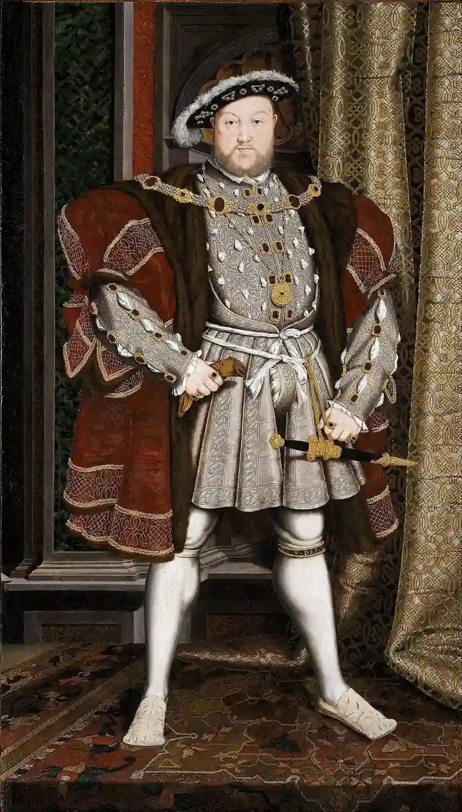
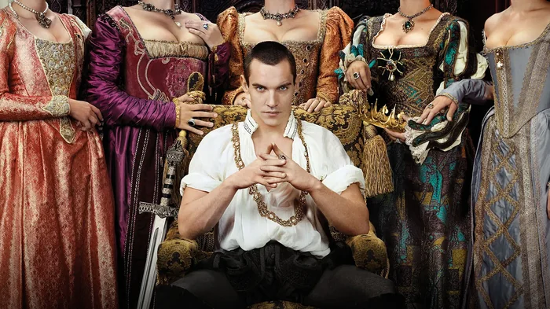
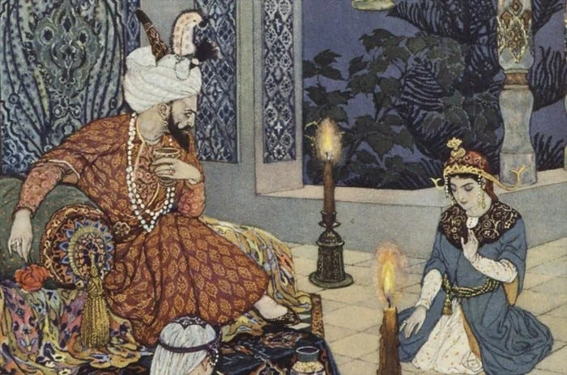
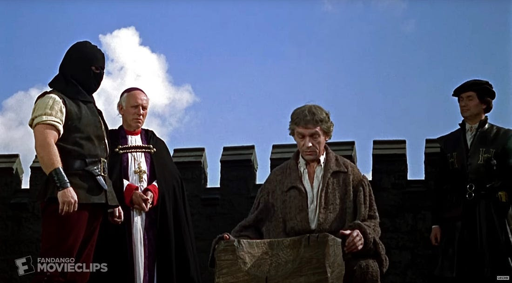
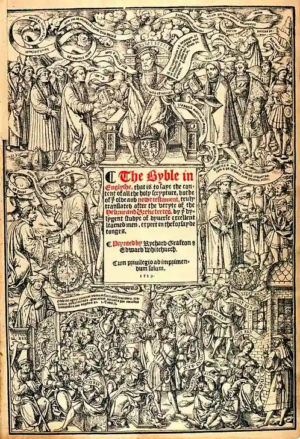

# On fascination by Tudors

**Date:** 2025-09-13 
**Author:** Kamil Kazani 
**Source:** https://kamilkazani.substack.com/p/on-fascination-by-tudors 
**Copied to Keg:** 2026-10-15 

---

My English friend once shared with me, how narrow, and how selective the standard school course of history feels, in England. For there are two topics really, two topics most students get acquainted with, and these two topics are:

1. World War II
2. Tudors

That is what everyone learns, and what everyone studies, more or less thoroughly.

World War II is sort of understandable. That is an apocalyptic war that finished the British empire and serves as a historical setting for the civic religion of modernity. The history of WWII is effectively a Biblical history of the modern world, and the references to the WWII can be best understood as Biblical references.

But why Tudors? Like, there have been many and many royal dynasties in the English history. There were Normans, Plantagenets, Lancasters, Yorks, Stuarts, Hanoverians, Saxe-Coburg-Gotha, and now the Battenbergs.

So why Tudors? Why single them out from this long, long line of monarchic succession, and zoom in on, and focus on them exclusively?

### Personally, it feels there have been more movies and series on Tudors alone, than on all the other British dynasties combined

Well, I think there is an emotional element here, an element of deeply emotional thrill and fascination. We study Tudors, for we are fascinated by Tudors, much like a man is naturally fascinated by a leopard. There is something wild, something dangerous, something savage and something totally foreign in that bygone dynasty, something that makes our blood pulse and our eyes zoom.

I would say, that is a certain paradox

On the one hand, they look determinedly modern. It is a dynasty of the Reformation, of parliaments, of commerce, and of global exploration, of the age of discovery, of all the things we tend to associate with modernity. They basically look as the modern people, as the people in suits, unlike these totally foreign, and totally incomprehensible people in armours and plates, before them

(last but not least, it is the first English dynasty to be truly well documented)

And. Here is the second part of our paradox. Despite all of their modern outfit, all their modern attire, the spirit, and the vibe of the dynasty - as that of the society they are ruling over - is distinctly… not modern! It is distinctly foreign, I would even say it feels distinctly… oriental (?)

For a modern, or even for a 19th c. Englishmen - the tales from the Tudor era (divorced - beheaded - died - divorced - beheaded - survived) feel oddly foreign, like something happening in a far off, mythical land. It feels more like a story from the Arabian Nights, like something happening in the legendary Baghdad from the age of Harun al-Rashid, or an even wilder story brought from the unknown land by Sinbad the Sailor.

For though Tudors, announced the birth of the modern world, they themselves belonged to the old one, and that makes the Tudor age to feel like the very last epoch when England was distinctly “oriental”, before it became a Western.

***

I have been reading lots of articles, and interviews, and debates on the Stalinist repressions, lately. Many of them were BS-ish, or just dull, explaining it all with the “mysterious” Russian (or Georgian) soul.

Some of them were more interesting, and had unusual, unobvious insights

For example. We are often puzzled and surprised by the behaviour of victims, of Stalinist purges. A person is getting accused of a completely made up, bizarre crime he most clearly did not commit. Sentenced to death, he is swearing his loyalty to the Soviet regime, professes his undying love to Joseph Stalin and dies with Stalin’s names on his lips.

And again, and again, and again, same story every time.

So the unusual insight I have stumbled upon lately is that,

### All of that is very similar to the behaviour of victims of political persecution in Tudor England

It literally feels like something happening in the age of Henry VIII. Made up accusation, clearly false one. Unfair, cruel prosecution, aimed to extract confession at any cost. Inevitable verdict of guilt, inevitable sentence, and inevitable execution. Before an execution, the victim reads a short address - how much he loves the king and long live the king - and off with his head.

Then the next person comes, and next one, and next.

*A man for all seasons (1966) may be my most favourite movie on Tudors’ era. Its ending feels almost grotesque, like something you could expect to see in the Death of Stalin.*

So what does this parallel - and a very astute parallel in my opinion - tells us about the reasons of our fascination by the Tudor age?

I think it is not only the sexual exploits of Henry VIII, or whoever, for we are not very much interested in amorous adventures of Stuart (or Hanoverian) kings nowadays. I think it is primarily the feeling of absolute, unconstrained, nonhuman power that makes every attempt of resistance ridiculous to even think of. All you can do is obey, and kneel, and submit, and swear your love and loyalty and die anyway.

A great deal of fascination before the Tudors derives from their superhuman, Juggernaut-ish power over the society they were ruling upon, the level of power never matched by any of the later dynasties. And if Tudors were able to get that level of power, that is primarily because the society Tudors were ruling over, was not very complex, yet.

It was dumb

***

Many, many years ago, I stumbled upon a problem. Look, I said. Religious history of England, and its ecclesiastical history makes absolutely zero sense. In the 17th c, in the Stuart age, the kings have surprisingly little power over what their subjects believe in. In the 1600s, it is the king who has to accommodate to the religious beliefs of England, and not the other way around.

Slight suspicion that you may be (just may be!) deviated from the one true version of Protestantism is enough to provoke a major political crisis. Like Charles I was a Protestant, firm and devoted. But the fact that he tried to promote a different sub-version of Protestantism (Arminian vs Calvinist theology) sufficed to undermine his rule and his legitimacy.

Decades later, Charles II again, had to accommodate to the Protestant frenzy of the country he ruled over. He had to sacrifice his Catholic friends and followers to the Protestant witch-hunt. Despite his lifelong sympathy to Catholicism, he finally embraced it on the deathbed only, as he knew that being a Catholic will be incompatible with holding the throne of England. As it was incompatible for his brother, and his Catholic religion was a major reason for his loss of power and for the expulsion of Stuart dynasty from England.

So, you see, Stuarts most clearly can not do what they want in terms of religion

Even their private beliefs could be problematic, and incompatible of power. Now changing the established religion of a country was just completely out of question

*I really like this frontpiece of Henry VIII’s Bible. High above, you see Henry himself, sitting on the throne and producing Biblical quotes, out of his mouth. He is the source, and his is the origins of Christian teaching. Below, you see the commonfolk, all praising and congratulating their king. God save the king, Vivat rex, is all they are saying. The message could not be more clear.*

But this does not seem to be the case for Tudors at all. In fact, the 1500s England produces a completely opposite impression, in every respect

Henry VIII wants to break with Rome. He breaks with it

His son Edward wants to break with Rome even further. Again, does it without any problem whatsoever

Now Mary does a complete U-turn, reconciliates with Rome, and returns England to Catholicism

Finally, Elizabeth does another U-turn, breaks with Rome again, and brings England to Protestantism

Left, right, left, right, left, right

Obviously, neither of these U-turns was completely smooth. All of them faced some resistance (including the armed one), and all had to been enforced with fire and blood, and with enormous violence. Yet, it worked every time, every single time without exception. Every time, you have some true believers trying to argue with the crown, and every time they get crushed, and they stand no chance, and the country will just submit to whatever creed their current king wants to submit them to.

The general impression is that the Tudors kings can do whatever they want, and their later successors just don’t have this power

Well, this impression is correct. That is clearly how it works in the 16th century. Through the Tudor era, the kings can do whatever they want. And that is because society they are ruling over is simple, poor and dumb

***

Our image of the early Tudor England is very much contaminated by the memes and by the impressions made by the later epochs, way richer, and way more refined. In the 1500s c, England was just the European periphery, rud-ish, dumb-ish, poor-ish. Nothing like the centre of the world it would become later

First, Tudor England was rude, ignorant. And it was exactly this rough, and this ignorance that made the job of changing religion every 15 minutes easier, and not harder.

In the year 1500, England has very few literate people. Even in the towns, literacy is a lot of a small minority. The great majority of population reads no books (including religious ones), reads no texts, and is in fact more or less completely ignorant about the church dogma. Whatever theological battles there are, they happen - and matter - for a tiny, tiny percentage of population that can even conceptualise what is going on, albeit in the rudest and most primitive form. Meanwhile, the vast majority of population is cut off from all these debates.

In the year 1600, England is a way more literate, bookish society. Partially as a result of reformation, partially as a result of printing press, partially as a result of the country just getting richer, it is way more permeated by all sorts of abstract, intellectual content, including religious one. Under the early Tudors, England has only a tiny fraction of people who has any idea of the church dogma, in any form whatsoever. Under the late Tudors, they comprise a very significant percentage of the overall population, especially in the more commercial and urbanised parts of the country.

Now a hard to swallow pill is. It is much, much harder to re-write all of these memes than just write them anew. In the beginning of Tudor era, most of England is a semi savage, semi barbarous society, not really acquainted with anything of that, in any form. Under the late Tudors, some sort of orthodoxy has been already established, and amending it becomes a dangerous, and - increasingly - impossible job.

Second. Early Tudor England is poor, landlocked. It is not a master of the seas, it will become later. It is not thinking like a maritime power, it is not acting like a maritime power. Both the character of the state, and of the economy are purely land based, or - at the very best - potamic.

In 1500, commercial expansion that would shed the untold riches on England has not even started. And how could it? The English sailors do not understand the sea, they scare away from the sea. When the English even interact with the sea, they treat it like a river. You need to cross the river, and load off the goods in the nearest seaport, and then return back by the same well known route. In practical terms, that means that the English trade is pretty much limited to the one single London-Antwerps lane. Navigating in the high seas, and in the unknown lands is completely out of question. Whenever English kings want to do that, they have to employ Italians

In 1550, it is barely starting. In fact, it is Richard Chancellor’s expedition to Muscovy, 1553-1554 that marks the moment when England finally takes off as a maritime power. It is an incredible moment, of truly global significance. For it implies that by the mid-16th c, England has trained one (1) native captain who can venture into the unknown seas, and not die.

Only around 1600, does the commercial and naval expansion of England start showing its first significant results. By that point, the critical mass of capable captains, and of capable crews has been trained. By that point, English commercial expansion is going in all directions, around the globe. By that point, the City of London starts accumulating first large, independent fortunes, more or less autonomous from the whim of the crown.

Now this is the point when the English Crown starts getting first, barely visible, signs of the potential threat from the society it is ruling upon. And that is because by that point society is getting too rich, too educated, and simply too complex for the barbarian political structure, that is simply not keeping the pace with all this increase in complexity happening under its (theoretical) oversight.

When the complexity of a ruled object (society) exceeds the complexity of the ruling subject (government), than the subject can either:

1. Reduce complexity of an object, by force. Impoverish, imbecilise, and primitivise it, so it will be easier to govern, again

2. No, there is no alternative to the solution presented above. Sad it may sound, alternative does not exist. For under the any alternative scenario imaginable, the ruling subject gonna have big, big problems

So, yes, the post-Tudor rulers of England will have lots of problems, for years to come

