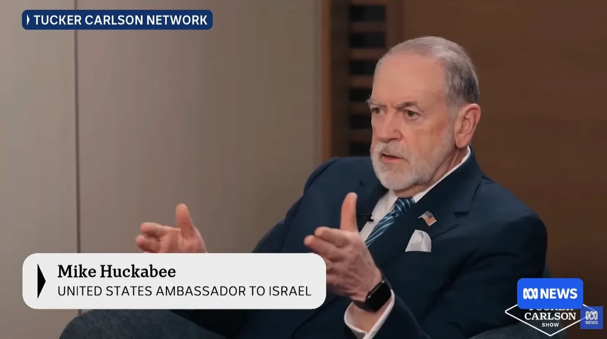

# People cannot lie

**Date:** 2026-03-06  
**Author:** Kamil Kazani  
**Source:** https://kamilkazani.substack.com/p/people-cannot-lie?utm_source=publication-search   
**Copied to Keg:** 2026-10-13 

---

What the interview with the ambassador Huckabee showed is that people cannot lie

No, I mean, of course they can. They can lie about what they had for lunch, about their routines, hunting & fishing achievements, etc. About all the trivial issues

But, by and large, most people find it exceedingly difficult to lie about their core beliefs

And that is the reason why most people are fundamentally honest about their convictions, and when it comes to their actual convictions

Let me explain you what I mean

Imagine a Western politician, or a public figure, talking about how deeply he is attached to the security and independence of Ukraine, and how he is fighting everyday for the repeal of Russian invasion. Is he telling the truth?

Not necessarily. It may very well be that this whole show is performative. It is absolutely conceivable that in reality he is not giving a flying damn about the whole thing, and is saying that for tactical/PR reasons

But it is extremely, extremely, extremely unlikely that he will be telling this while being a hardcore supporter of Russia. For a simple reason that most people will be struggling with it, no matter what the public imagines. Most people, and most politicians are simply not machiavellian enough for that

If he is not attached to Russia/Ukraine at all and sees it as a somewhat comical conflict between the two tribes of subhuman savages, then he can performatively take whatever position he finds more advantageous right now, because nothing of that touches his core beliefs, and his actual political stances. He can declare for Ukraine today and for Russia tomorrow, because he has nothing personal for/against either.

But if he is attached, and has strong opinion about the conflict, he will find it extremely, extremely, extremely difficult to abstain from disclosing his honest opinion, no matter how disadvantageous it can be.

Now forget about Ukraine and imagine that the conversation is switching to the problems of his native Slovetsia. You will immediately notice that the whole fabric of conversation changes. That is because he is attached to Slovetsia, and attached deeply. He remembers all the towns & fortresses annexed from Slovetsia by the hostile Bulbustan, back in the 17th c, and will never forget nor truly forgive that horrible injustice.

The whole conversation becomes more emotional and much less strategic

That is because when it comes to the dear, beloved Slovetsia a politician cannot lie.

Territorial integrity of Slovetsia, and not in its present (unjust!) lines, but in its true, historical shape belongs to the core of his beliefs. That is what he can’t lie about, not even when it would be in his interest to lie.

He can twist it a little bit of course. Bend it, here and there. He can practice the art of strategic omission, when omission does serve his interests. But he won’t twist it very much. He will tell you his honest opinion, if you just bother to ask.

For the most part, people don’t lie about their actual, core beliefs

And are honest regarding whom they consider their foes or friends

For a simple reason that everything else is just too difficult psychologically

When it comes to the core of one’s beliefs, one can tell the truth, or one can shut the hell up. And you cannot just shut the hell up in an interview. That is not really an option.

Hence, the superpower of the follow up questions