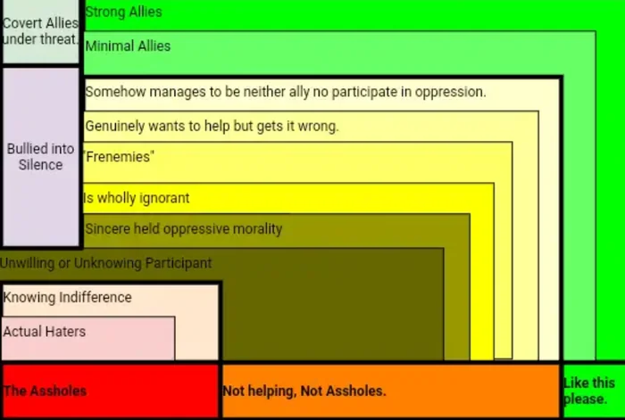

# The Ontrology of Haters

**Author:** Razlynne 
**Date:** 2023 
**Source:** friend 
**Copied to Keg:** 2026-10-26 

***

Here it is.

The key insights I wouldn't want lost from this:

1. Allies and neutral but curious parties can be bullied into non-participation through a combination of intimidation based fear and ignorance.   
    *This means public messaging form people able to engage with the risk is a powerful solution that can yield extensive gains if done to this end.*
2. Overt haters are actually rare.   
    *These are the people doing it on purpose.   We have words for these people and privilege, while generally relevant, is really the proper term for what's going on here.  The intent to harm is real.*
3. Strong Allies are also similarly rare.
    *Allyship is defined by action.*   
4. Most people exist in some nebulous state of not doing it on purpose and not taking actions to establish allyship.    
    *This does not change the reality of their actions and impacts.* 
    *This does directly prescribes how to effectively engage with them.* 
    *"Sincerely Held Oppressive Morality" is a mouthful and I need a better way to describe it, this is one of the undone parts but basically it's the hardest group of people to deal with.  These people really believe that god says do unto whoever, whatever it is that they believe is divinely prescribed.   I don't have good answers here other than that it's really easy to push these people into the doing it on purpose camp if they're attacked directly because they belive they hold the moral high ground.* 

