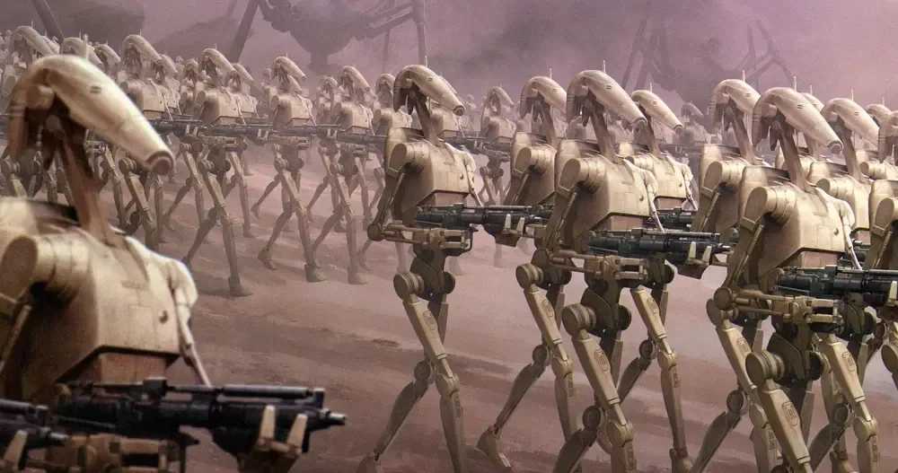

<!-- # Shaq Candy

**Author:** Emmanuel Schalk 
**Date:** 2026-06-17 

> The line has to be drawn somewhere.

---

I recently purchased a discount bag of "Shaq-a-licious XL Gummies", I used how stupid the name sounded as justification. I lie to myself when I buy candy. Candy has never solved my problems. But I keep finding excuses. This time it was "What the hell is this? Shaq? Is there anything special about these?" 

shaq_candy_package

*What is this?*

No there wasn't anything special about them except that they tried to make each piece of candy look like Shaq. It did not work. (Glue stick for reference)

*Huh? That looks terrible*

Shaq is by some measures the best basketball player ever. At least that's my opinion. He's an interesting person  -->