# Introduction to Kegology

**Author:** Emmanuel Schalk 
**Date:** 2026-11-01 
**Status:** Currently just a draft 
**Date complete:** 

> Use Monopoly to create your Disciplined Moment

---

<!-- 
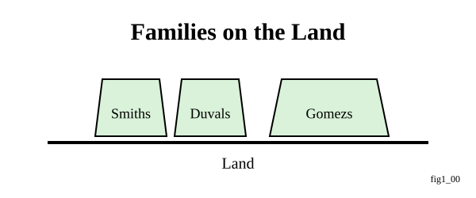
   

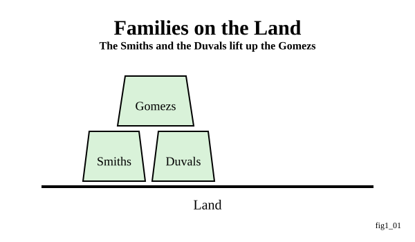
   

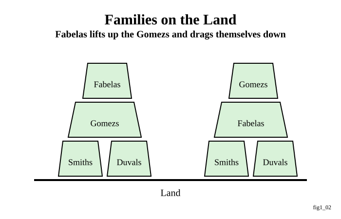
   

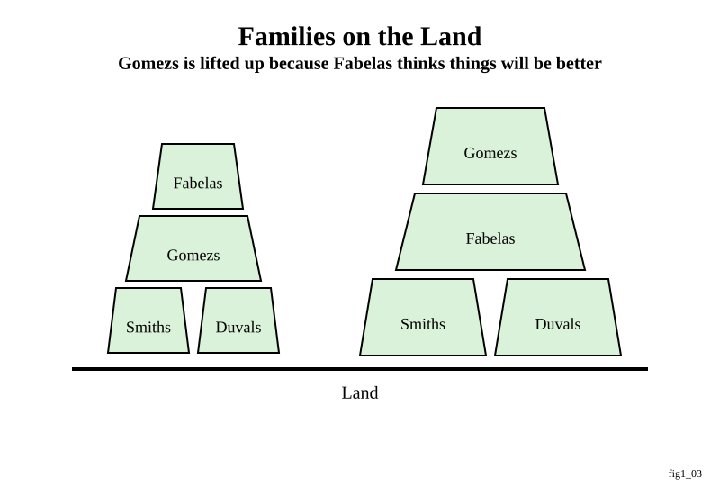
   

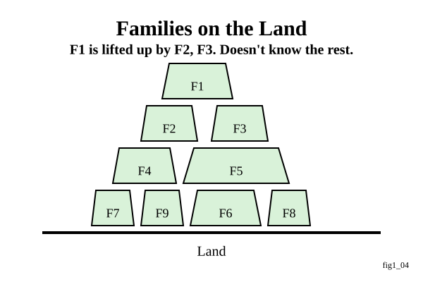
   

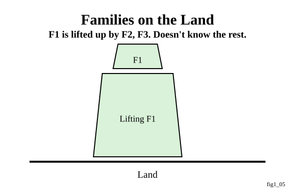
    -->

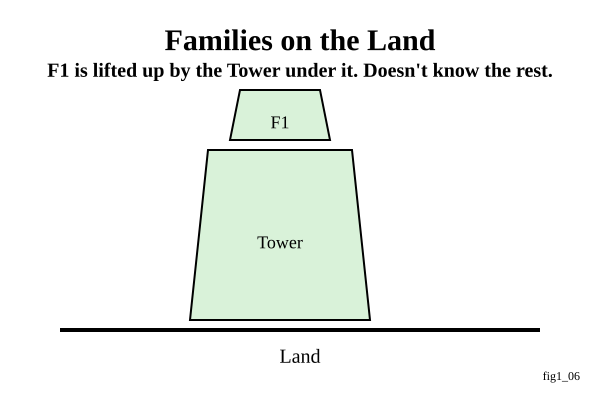
   

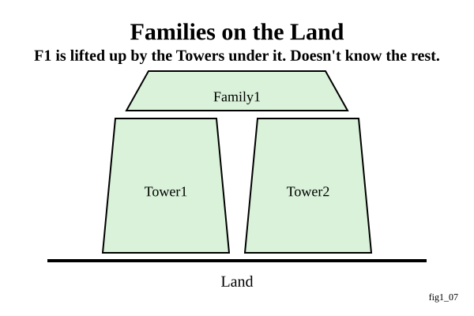
   

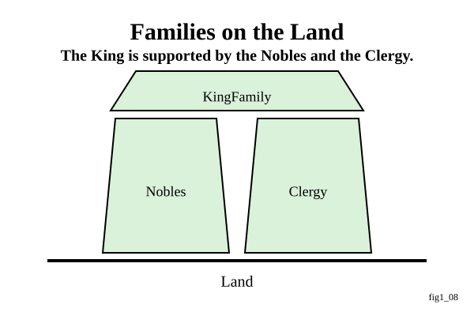
   

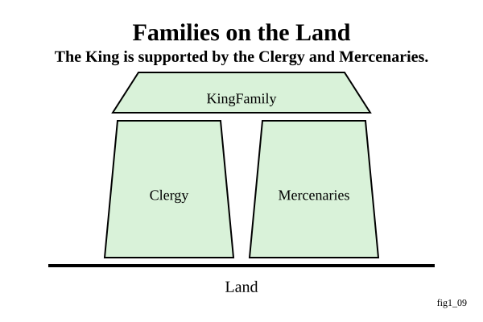
   

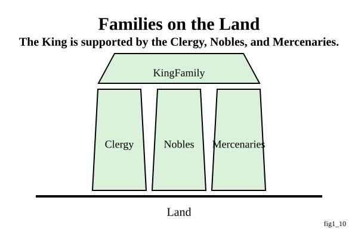
   

<!--Home: Implied background -->
<!--Need: Always wanted to be a good father. Stop climate change -->
<!--Refusal of the call: Steve said "What am I supposed to do about it? -->
<!--Go: Try to answer the question -->
<!--Search: I knew it would be hard. I didn't know it would be 30 years. -->
<!--Find: created Kegology - Ask your neighbors what they want (How to ask?) -->
<!--Take: What privledge will children lose? Am I a good father if I give them chaos -->
<!--Return: I need to have more faith in my nieghbors -->
<!--Change: I have more faith in my neighbors -->

